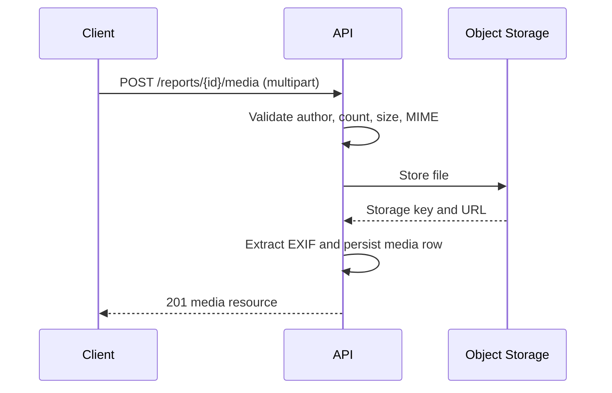

# API Requirements Document

**Project:** WARTA  
**Document Version:** 1.0  
**Status:** Draft  
**Date:** 3 November 2026  
**API Style:** REST over HTTPS, JSON  
**Source of Truth:** `docs/database/database-design.md`

---

## 1. Introduction

### 1.1 Purpose

This document defines the API requirements derived from the WARTA database design.

It specifies the resources, endpoints, request and response contracts, validation rules, error behavior, and non-functional requirements needed by the `landing/` and `admin/` clients.

It is a contract for backend implementation. It does not contain executable code.

### 1.2 Scope

The API covers:

- Citizen registration, login, and profile retrieval.
- Project catalog browsing, detail views, and map pins.
- Project tender history, locations, and risk indicators.
- Condition reports, including draft and submit flows.
- Report photo attachments.
- Location claims submitted by citizens.
- Additional evidence attached to reports.
- The unified verification queue and citizen votes.
- Public user profiles limited to the display name.

The API does not expose:

- Password hashes or any credential material.
- Email addresses in public responses.
- Direct writes to verification states, vote counters, or project status.
- Import or ingestion endpoints for SPSE data.

### 1.3 Audience

| Audience | Use |
|---|---|
| Backend developers | Implement handlers, validation, and persistence. |
| Frontend developers | Consume endpoints and map responses into the existing TypeScript types. |
| QA engineers | Derive test cases from the endpoint catalogue and validation matrix. |

### 1.4 Definitions

| Term | Meaning |
|---|---|
| Guest | An unauthenticated visitor. Read-only access. |
| Citizen | An authenticated user with a row in `users`. |
| Author | The citizen who created a report, claim, or evidence row. |
| Verification item | A queue entry representing a report or a location claim awaiting consensus. |
| Derived field | A response value computed by the API, not stored in the database. |

---

## 2. API Conventions

### 2.1 Base URL and Versioning

```
https://<host>/api/v1
```

- The major version is part of the path.
- Breaking changes require a new major version.
- Additive fields are allowed within a version; clients must ignore unknown fields.

### 2.2 Transport and Format

| Item | Requirement |
|---|---|
| Protocol | HTTPS only. Plain HTTP is rejected outside local development. |
| Request body | `application/json; charset=utf-8` |
| File upload | `multipart/form-data` |
| Response body | `application/json; charset=utf-8` |
| Compression | `gzip` or `br` when the client sends `Accept-Encoding`. |
| Character set | UTF-8. Indonesian text must round-trip without loss. |

### 2.3 Field Naming

- JSON field names use `snake_case`, matching the database columns.
- Clients map these fields into their existing `camelCase` TypeScript types.
- Enumerations use the exact canonical values stored in the database.

### 2.4 Identifiers

- All primary keys are UUID v4 strings.
- Path parameters accepting an ID must return `400` for a malformed UUID and `404` for a well-formed UUID that does not exist.

### 2.5 Timestamps

- All timestamps are ISO 8601 UTC strings: `2026-11-03T14:05:00Z`.
- The server sets `created_at` and `updated_at`. Clients cannot set them.
- `submitted_at` and `decided_at` are server-set transition timestamps.

### 2.6 Monetary Values

- Amounts are returned as decimal strings to avoid floating-point loss: `"516020000000.00"`.
- `contract_amount` may be `null`. It must never be coerced to `"0.00"`.
- Compact and full display forms are derived fields returned alongside the raw value.

### 2.7 Response Envelope

Single resource:

```json
{
  "data": { "id": "…" }
}
```

Collection:

```json
{
  "data": [ { "id": "…" } ],
  "meta": {
    "page": 1,
    "limit": 20,
    "total": 137,
    "has_next": true
  }
}
```

Error:

```json
{
  "error": {
    "code": "validation_failed",
    "message": "One or more fields are invalid.",
    "details": [
      { "field": "narrative", "message": "Must be between 20 and 500 characters." }
    ]
  }
}
```

### 2.8 Conditional Requests

- `GET` responses for public resources must include `ETag`.
- Clients may send `If-None-Match`; the server returns `304 Not Modified` when unchanged.
- Public catalog responses may be cached for 60 seconds.

---

## 3. Authentication and Authorization

### 3.1 Authentication

- Authentication uses a bearer JWT: `Authorization: Bearer <token>`.
- Tokens are issued by `POST /auth/login`.
- Default token lifetime is 3600 seconds.
- The client stores the token and attaches it to every authenticated request.
- Guest requests carry no `Authorization` header.

### 3.2 Authorization Model

The database defines no privileged role. Authorization is therefore limited to:

| Rule | Applies to |
|---|---|
| Public read | Projects, tenders, locations, reports, claims, evidence, queue, public profiles. |
| Authenticated write | Creating reports, claims, evidence, media, and votes. |
| Verified email required | Content writes require `users.email_verified_at`. Reading remains available while unverified. |
| Author-only write | Editing one's own draft report; deleting one's own report before a verdict; deleting one's own media before submission. |
| Anti-self-verification | An author cannot vote on a report or claim they created. |
| No status writes | No client may set `status`, vote counters, or `resolved_at` directly. |

### 3.3 Guest Permissions

Guests may:

- List and read projects, tender history, locations, risk flags, and map pins.
- Read submitted reports, location claims, evidence, and the verification queue.
- Read public user profiles.

Guests may not:

- Create reports, claims, evidence, media, or votes.
- Read their own profile or vote history.

Attempting a write as a guest returns `401`.

### 3.4 Account States

- `users.is_active = false` means the account is deactivated.
- A deactivated account cannot log in and receives `403` on authenticated endpoints.
- Public reads of a deactivated author still return the stored `display_name`.

### 3.5 Email Verification

- `users.email_verified_at` is null until the address is confirmed.
- Registration sends a verification link valid for 24 hours.
- Unverified accounts may log in and browse, but any content write returns `403 email_not_verified`.
- `POST /auth/verify-email` confirms the token and sets `email_verified_at`.
- `POST /auth/resend-verification` issues a new token, limited to 3 requests per hour per account.
- Verification tokens are single-use and stored hashed. The raw token appears only in the email.
- `is_active` and email verification are independent. A deactivated account remains blocked even when verified.
- Verifying an already verified address returns `409 email_already_verified`.

---

## 4. Resource Model

### 4.1 Table-to-Resource Mapping

| Table | Resource | Exposed as |
|---|---|---|
| `users` | User | `/users/{id}`, `/users/me`, `/auth/*` |
| `projects` | Project | `/projects`, `/projects/{id}` |
| `project_years` | Project year | Embedded in project detail |
| `project_tenders` | Tender | `/projects/{id}/tenders` |
| `project_locations` | Location | `/projects/{id}/locations` |
| `project_risk_flags` | Risk flag | Embedded in project detail |
| `reports` | Report | `/projects/{id}/reports`, `/reports/{id}` |
| `report_media` | Report photo | `/reports/{id}/media` |
| `location_claims` | Location claim | `/projects/{id}/location-claims`, `/location-claims/{id}` |
| `claim_media` | Claim photo | `/location-claims/{id}/media` |
| `verification_items` | Verification item | `/verification-items`, `/projects/{id}/verification-items` |
| `verification_votes` | Vote | `/verification-items/{id}/votes` |
| `evidences` | Evidence | `/reports/{id}/evidences`, `/evidences/{id}` |
| `evidence_media` | Evidence photo | `/evidences/{id}/media` |

### 4.2 Resources With No Direct Write Endpoint

The following are server-managed and must not expose `POST`, `PATCH`, or `DELETE`:

| Resource | Reason |
|---|---|
| `project_years` | Derived from source import data. |
| `project_tenders` | Populated by the SPSE import process. |
| `project_locations` | Created by the import process or by an accepted claim. |
| `project_risk_flags` | Generated by a rule engine. |
| `verification_items` | Created automatically when a report or claim is submitted. |
| `verification_votes` | Immutable after creation; only `POST` creates one. |
| `projects.status` | Cached roll-up of report statuses. |

---

## 5. Endpoint Catalogue

### 5.1 Authentication and Profile

| Method | Path | Auth | Purpose |
|---|---|---|---|
| POST | `/auth/register` | Guest | Create a citizen account and send a verification email. |
| POST | `/auth/login` | Guest | Exchange credentials for a token. |
| POST | `/auth/verify-email` | Guest | Confirm an email address with a verification token. |
| POST | `/auth/resend-verification` | Citizen | Send a new verification email. |
| POST | `/auth/logout` | Citizen | Revoke the current token. |
| GET | `/auth/me` | Citizen | Return the authenticated citizen's private profile. |
| PATCH | `/users/me` | Citizen | Update `display_name`. |
| DELETE | `/users/me` | Citizen | Deactivate the account. |
| GET | `/users/me/reports` | Citizen | List reports authored by the caller. |
| GET | `/users/me/claims` | Citizen | List location claims authored by the caller. |
| GET | `/users/me/votes` | Citizen | List votes cast by the caller. |
| GET | `/users/{user_id}` | Public | Return a public profile. |

### 5.2 Projects

| Method | Path | Auth | Purpose |
|---|---|---|---|
| GET | `/projects` | Public | List and filter the project catalog. |
| GET | `/projects/{project_id}` | Public | Return one project with derived detail. |
| GET | `/projects/{project_id}/tenders` | Public | Return tender history. |
| GET | `/projects/{project_id}/locations` | Public | Return primary and sub-locations. |
| GET | `/projects/{project_id}/risk-flags` | Public | Return active risk indicators. |
| GET | `/projects/{project_id}/reports` | Public | Return submitted reports for the project. |
| GET | `/projects/{project_id}/location-claims` | Public | Return location claims for the project. |
| GET | `/projects/{project_id}/verification-items` | Public | Return the project's verification queue. |
| GET | `/projects/map` | Public | Return lightweight map pins. |

### 5.3 Reports and Evidence

| Method | Path | Auth | Purpose |
|---|---|---|---|
| POST | `/projects/{project_id}/reports` | Citizen | Create a draft or submit a report. |
| GET | `/reports/{report_id}` | Public | Return one report with media and evidence counts. |
| PATCH | `/reports/{report_id}` | Author | Update a draft report. |
| DELETE | `/reports/{report_id}` | Author | Delete a report before a consensus verdict. |
| POST | `/reports/{report_id}/submit` | Author | Submit a draft and enqueue it. |
| GET | `/reports/{report_id}/media` | Public | List report photos. |
| POST | `/reports/{report_id}/media` | Author | Upload a report photo. |
| DELETE | `/reports/{report_id}/media/{media_id}` | Author | Remove a report photo before submission. |
| GET | `/reports/{report_id}/evidences` | Public | List additional evidence. |
| POST | `/reports/{report_id}/evidences` | Citizen | Add additional evidence. |
| GET | `/evidences/{evidence_id}` | Public | Return one evidence entry. |
| GET | `/evidences/{evidence_id}/media` | Public | List evidence photos. |
| POST | `/evidences/{evidence_id}/media` | Author | Upload an evidence photo. |
| DELETE | `/evidences/{evidence_id}/media/{media_id}` | Author | Remove an evidence photo. |

### 5.4 Location Claims

| Method | Path | Auth | Purpose |
|---|---|---|---|
| POST | `/projects/{project_id}/location-claims` | Citizen | Create a location claim. |
| GET | `/location-claims/{claim_id}` | Public | Return one claim. |
| GET | `/location-claims/{claim_id}/media` | Public | Return the claim photo. |
| POST | `/location-claims/{claim_id}/media` | Author | Upload the claim photo. |
| DELETE | `/location-claims/{claim_id}/media/{media_id}` | Author | Remove the claim photo before consensus. |

### 5.5 Verification and Votes

| Method | Path | Auth | Purpose |
|---|---|---|---|
| GET | `/verification-items` | Public | List the unified queue. |
| GET | `/verification-items/{item_id}` | Public | Return one queue item. |
| GET | `/verification-items/{item_id}/votes` | Public | List votes for an item. |
| POST | `/verification-items/{item_id}/votes` | Citizen | Cast one vote. |

---

## 6. Endpoint Specifications

### 6.1 POST `/auth/register`

Request:

```json
{
  "display_name": "warga_jakarta",
  "email": "warga@example.com",
  "password": "correct-horse-battery"
}
```

Validation:

- `display_name`: 3–24 characters, letters, numbers, underscore only, unique case-insensitively.
- `email`: valid address, unique case-insensitively, maximum 255 characters.
- `password`: 8–72 characters. The 72-byte limit matches the hashing algorithm boundary.
- The server hashes the password. The request body never stores a hash.

Response `201`:

```json
{
  "data": {
    "id": "0f0f0f0f-0000-4000-8000-000000000001",
    "display_name": "warga_jakarta",
    "email": "warga@example.com",
    "is_active": true,
    "created_at": "2026-11-03T14:05:00Z"
  }
}
```

Errors:

- `409` when `display_name` or `email` is already taken.
- `422` on validation failure.

### 6.2 POST `/auth/login`

Request:

```json
{ "email": "warga@example.com", "password": "correct-horse-battery" }
```

Response `200`:

```json
{
  "data": {
    "access_token": "eyJhbGciOi…",
    "token_type": "Bearer",
    "expires_in": 3600,
    "user": {
      "id": "0f0f0f0f-0000-4000-8000-000000000001",
      "display_name": "warga_jakarta",
      "email": "warga@example.com",
      "email_verified_at": "2026-11-03T14:10:00Z"
    }
  }
}
```

Errors:

- `401` for unknown email or wrong password. The message must not reveal which field failed.
- `403` when the account is deactivated.

### 6.3 GET `/auth/me`

Returns the caller's private profile. This is the only endpoint that may return `email`.

```json
{
  "data": {
    "id": "0f0f0f0f-0000-4000-8000-000000000001",
    "display_name": "warga_jakarta",
    "email": "warga@example.com",
    "email_verified_at": "2026-11-03T14:10:00Z",
    "is_active": true,
    "created_at": "2026-11-03T14:05:00Z",
    "updated_at": "2026-11-03T14:05:00Z"
  }
}
```

### 6.4 GET `/users/{user_id}`

Returns the public profile only.

```json
{
  "data": {
    "id": "0f0f0f0f-0000-4000-8000-000000000001",
    "display_name": "warga_jakarta",
    "is_active": true,
    "created_at": "2026-11-03T14:05:00Z"
  }
}
```

The response must never contain `email` or `password_hash`.

### 6.5 PATCH `/users/me`

Request:

```json
{ "display_name": "warga_baru" }
```

- Only `display_name` is mutable.
- Changing it updates the name shown on all past reports, claims, and votes.
- `409` when the new name is taken.
- `422` when the format is invalid.

### 6.6 GET `/projects`

Query parameters:

| Parameter | Type | Notes |
|---|---|---|
| `q` | string | Matches project title. |
| `category` | string | One category name. |
| `city` | string | Administrative city. |
| `status` | string | `menunggu`, `terverifikasi`, `ditolak`, `selesai`. |
| `year` | integer | Fiscal year, matched through `project_years`. |
| `precision_level` | string | One allowed precision value. |
| `is_outside_dki` | boolean | Filter projects outside DKI Jakarta. |
| `is_retender` | boolean | Filter projects with a failed tender. |
| `sort` | string | `title`, `-created_at`, `pagu_amount`, `-pagu_amount`. |
| `page` | integer | 1-based. Default 1. |
| `limit` | integer | Default 20, maximum 100. |

Response `200` returns a collection of project summaries. Each summary must include:

- `id`, `title`, `spse_code`, `satker`, `category`, `city`
- `pagu_amount`, `hps_amount`, `contract_amount`, `contract_available`
- `years` as an integer array
- `precision_level`, `location_source`, `is_canonical_claimed`
- `is_outside_dki`, `is_retender`
- `reports_count`, `verifications_count`
- `status`
- Derived: `pagu_compact`, `pagu_full`, `hps_compact`, `hps_full`, `kontrak_compact`, `kontrak_full`

### 6.7 GET `/projects/{project_id}`

Returns one project with its related rows:

```json
{
  "data": {
    "id": "…",
    "title": "…",
    "spse_code": "…",
    "satker": "…",
    "category": "…",
    "pagu_amount": "516020000000.00",
    "hps_amount": "516020000000.00",
    "contract_amount": null,
    "contract_available": false,
    "contract_note": "Nilai kontrak belum dipublikasikan.",
    "years": [2025, 2026, 2027],
    "city": "Jakarta Selatan",
    "is_outside_dki": false,
    "location": {
      "address": "…",
      "city": "Jakarta Selatan",
      "precision_level": "kecamatan",
      "source": "SPSE",
      "is_canonical_claimed": false,
      "latitude": -6.2615,
      "longitude": 106.8106
    },
    "precision_resolution_note": "…",
    "tenders": [
      { "id": "…", "spse_code": "…", "status": "gagal", "note": "…" }
    ],
    "sub_locations": [
      { "id": "…", "name": "…", "address": "…", "city": "…", "verified": true }
    ],
    "risk_flags": [
      { "code": "CONTRACT_MISSING", "label": "…", "level": "warning", "description": "…" }
    ],
    "reports_count": 4,
    "verifications_count": 12,
    "status": "menunggu",
    "source_note": "…",
    "derived": {
      "pagu_compact": "Rp516,02 miliar",
      "pagu_full": "Rp516.020.000.000",
      "precision_badge": "Kecamatan",
      "is_retender": true
    }
  }
}
```

Rules:

- `contract_amount` stays `null` when unpublished. `contract_available` must be `false`.
- `is_retender` is derived from the presence of a failed tender.
- `sub_locations` may be empty.
- The response must not expose `email` anywhere.

### 6.8 GET `/projects/map`

Query parameters:

| Parameter | Type | Notes |
|---|---|---|
| `bbox` | string | `minLng,minLat,maxLng,maxLat`. Required. |
| `status` | string | Optional status filter. |
| `category` | string | Optional category filter. |

Response `200`:

```json
{
  "data": [
    {
      "id": "…",
      "title": "…",
      "latitude": -6.2615,
      "longitude": 106.8106,
      "precision_level": "kecamatan",
      "status": "menunggu",
      "category": "…"
    }
  ]
}
```

- `latitude` and `longitude` may be `null` when the project has no coordinates.
- The derived SVG position in the mockup is not an API concern.

### 6.9 GET `/projects/{project_id}/tenders`

```json
{
  "data": [
    {
      "id": "…",
      "spse_code": "…",
      "status": "gagal",
      "note": "…",
      "created_at": "2026-11-03T14:05:00Z"
    }
  ]
}
```

- Rows are ordered by `created_at` ascending.
- The current tender is available on the project resource as `spse_code`.

### 6.10 GET `/projects/{project_id}/locations`

```json
{
  "data": {
    "primary_location_id": "…",
    "locations": [
      {
        "id": "…",
        "name": "…",
        "address": "…",
        "city": "…",
        "precision_level": "alamat/ruas",
        "source": "warga",
        "latitude": -6.2,
        "longitude": 106.8,
        "is_verified": true,
        "is_primary": true
      }
    ]
  }
}
```

- Exactly one location has `is_primary = true`.
- Coordinates are either both present or both `null`.

### 6.11 POST `/projects/{project_id}/reports`

Creates a report as a draft or submits it immediately.

Request:

```json
{
  "category": "fisik_rusak",
  "narrative": "Papan proyek sudah tidak ada dan bekas cor beton retak di beberapa titik.",
  "proposed_address": "Jl. Contoh No. 10, Kelurahan Contoh",
  "latitude": -6.2615,
  "longitude": 106.8106,
  "exif_status": "valid",
  "exif_notice": null,
  "submit": false
}
```

Rules:

- The caller becomes `user_id`. Clients cannot set `user_id`.
- `submit: false` creates a `draft`.
- `submit: true` performs the submit validation and enqueues a verification item.
- `distance_from_project` is computed by the server from the project's primary location.
- `status`, `submitted_at`, and `created_at` are server-controlled.

Response `201` returns the report with `status` and `id`.

Submit-time validation:

| Field | Rule |
|---|---|
| `category` | Required. One allowed category value. |
| `narrative` | 20–500 characters. |
| `proposed_address` | Required. |
| `latitude` / `longitude` | Both present or both absent. |
| `media` | At least one report photo must already exist. |

Errors:

- `422` with field-level details.
- `409` when the project already has an accepted location claim that blocks this action, if a policy is added later.

### 6.12 POST `/reports/{report_id}/submit`

- Author-only. Submitting someone else's draft returns `403`.
- Transitions `draft` to `menunggu`.
- Sets `submitted_at` to the current time.
- Creates exactly one `verification_items` row with `item_type = laporan_kondisi`.
- Returns `409` if the report is not a draft.
- Returns `422` if the report has no photo, no category, or a narrative outside 20–500 characters.

### 6.13 PATCH `/reports/{report_id}`

- Author-only and draft-only.
- Accepts `category`, `narrative`, `proposed_address`, `latitude`, `longitude`.
- Returns `409` when the report is no longer a draft.
- The server refreshes `updated_at`.

### 6.14 DELETE `/reports/{report_id}`

- Author-only.
- Allowed while the report has no consensus verdict: `draft` or `menunggu`.
- Returns `204` on success.
- A `draft` is hard-deleted and cascades to `report_media`.
- A `menunggu` report is soft-deleted: `reports.deleted_at` is set, the report disappears from public lists and the verification queue, and its verification item is closed. Media, votes, and the audit trail are retained.
- Returns `409` when the report is `terverifikasi`, `ditolak`, or `selesai`. Those states are part of the public record.
- Deleting a pending report does not change the project status and does not reverse an accepted location claim.
- The response is `204` whether the report was a draft or a pending submission.

### 6.15 POST `/reports/{report_id}/media`

`multipart/form-data`:

| Part | Type | Notes |
|---|---|---|
| `file` | binary | Required. JPEG, PNG, or WebP. |
| `sort_order` | integer | 0–3. Optional; defaults to the next free slot. |

Rules:

- Maximum 4 photos per report.
- Maximum 5 MB per photo.
- The server extracts EXIF metadata and sets `exif_latitude`, `exif_longitude`, `exif_taken_at`, and `is_geotag_valid`. Clients cannot forge these values.
- The server rejects non-image MIME types with `415`.
- The server stores the file in object storage and persists only `file_url`.

Errors:

- `409` when a fifth photo is added.
- `413` when the file exceeds 5 MB.
- `415` for an unsupported type.

### 6.16 POST `/projects/{project_id}/location-claims`

Request:

```json
{
  "proposed_address": "Jl. Contoh No. 10, RT 04/RW 02",
  "address_line": "Jl. Contoh No. 10",
  "kelurahan": "Contoh",
  "kecamatan": "Contoh",
  "city": "Jakarta Selatan",
  "landmark": "Sebelah masjid",
  "proposed_precision": "alamat/ruas",
  "latitude": -6.2615,
  "longitude": 106.8106
}
```

Rules:

- `address_line` is required unless `proposed_precision` is `kecamatan` or `desa/kelurahan`.
- At most one accepted claim per project.
- The claim is created with `status = menunggu` and enters the queue as `klaim_lokasi`.
- `distance_from_project` is computed by the server.
- The caller becomes `user_id`.

Errors:

- `409` when the project already has an accepted claim.
- `422` on missing address or invalid precision.

### 6.17 POST `/verification-items/{item_id}/votes`

Request:

```json
{ "choice": "setuju" }
```

Rules:

- The caller becomes `user_id`.
- One vote per citizen per item.
- The author of the underlying report or claim cannot vote.
- Voting on a resolved item returns `409`.
- Votes are immutable; there is no `PATCH` or `DELETE`.
- The server updates `votes_agree` or `votes_disagree` atomically.
- Reaching `target_votes` agree votes sets `terverifikasi`; for a claim the accepted status becomes `diterima`.
- Reaching `target_votes` disagree votes sets `ditolak`.
- An accepted claim creates a new primary location with `source = warga` and updates `projects.primary_location_id`.

Response `201`:

```json
{
  "data": {
    "id": "…",
    "verification_item_id": "…",
    "user_id": "…",
    "choice": "setuju",
    "created_at": "2026-11-03T14:05:00Z"
  }
}
```

Errors:

- `409` for a duplicate vote.
- `403` for a self-vote.
- `409` for a resolved item.
- `422` for an invalid `choice`.

### 6.18 POST `/reports/{report_id}/evidences`

Request:

```json
{
  "description": "Foto tambahan menunjukkan retakan yang sama dari sisi jalan."
}
```

- Any authenticated citizen may add evidence, including the report author.
- Evidence does not create a verification item.
- Evidence is not a standalone report.

### 6.19 Consistency Rules for Media

- A media row belongs to exactly one report, claim, or evidence.
- Deleting a parent cascades to its media rows.
- Deleting a report photo is allowed only while the report is a draft.
- Deleting a report photo is not possible after submission. Withdrawing a pending report removes it from public view with the report.
- Deleting a claim photo is allowed only while the claim is `menunggu`.
- An evidence photo may be deleted by its author while the evidence is not yet reviewed.

### 6.20 POST `/auth/verify-email`

Request:

```json
{ "token": "eyJhbGciOi…" }
```

Rules:

- The token is single-use and valid for 24 hours.
- A valid token sets `users.email_verified_at` and returns the private profile.
- The endpoint is public: the token carries the account identity.
- An expired or tampered token returns `422 validation_failed`.
- Verifying an already verified address returns `409 email_already_verified`.

### 6.21 POST `/auth/resend-verification`

- Authenticated, and only meaningful while `email_verified_at` is null.
- Sends a new token and invalidates the previous one.
- Rate limited to 3 requests per hour per account.
- Returns `204` regardless of whether a new email was actually sent, so the endpoint cannot be used to probe account state. An already verified account behaves the same: nothing is sent and no token is issued, and the request still spends its rate-limit budget. `409 email_already_verified` is reserved for `/auth/verify-email` (§6.20).

### 6.22 GET `/users/me/votes`

Returns the caller's vote history with the current outcome of each voted item.

Query parameters: `page`, `limit`.

Response `200`:

```json
{
  "data": [
    {
      "id": "7c2e…",
      "verification_item_id": "9a7c…",
      "project_id": "3b1e…",
      "project_title": "Rehabilitasi Saluran Drainase",
      "item_type": "laporan_kondisi",
      "author_display_name": "warga_lain",
      "choice": "setuju",
      "created_at": "2026-11-03T14:05:00Z",
      "resolution": {
        "status": "terverifikasi",
        "votes_agree": 3,
        "votes_disagree": 0,
        "target_votes": 3,
        "resolved_at": "2026-11-04T09:12:00Z"
      }
    }
  ],
  "meta": {
    "page": 1,
    "limit": 20,
    "total": 4,
    "has_next": false
  }
}
```

Rules:

- `resolution` is always present, even while the item is still pending.
- `resolution.status` uses the union `menunggu`, `terverifikasi`, `ditolak`, `diterima`. A claim resolves to `diterima`, not `terverifikasi`.
- `resolution` is the item's **current** state, not a snapshot from the moment of voting. Voting is only possible while an item is `menunggu`, so the outcome always post-dates the vote.
- The API does not return a "your vote won" flag. Clients derive it: `choice = setuju` with `terverifikasi` or `diterima`, or `choice = tidak_setuju` with `ditolak`.
- The endpoint does not promise an `ETag`; the outcome can change between requests.
- The response never includes `email`.

---

## 7. Request and Response Schemas

### 7.1 Report Resource

```json
{
  "id": "…",
  "project_id": "…",
  "user_id": "…",
  "author_display_name": "warga_jakarta",
  "category": "fisik_rusak",
  "narrative": "…",
  "proposed_address": "…",
  "latitude": -6.2615,
  "longitude": 106.8106,
  "distance_from_project_m": 38.4,
  "exif_status": "valid",
  "exif_notice": null,
  "status": "menunggu",
  "created_at": "2026-11-03T14:05:00Z",
  "updated_at": "2026-11-03T14:05:00Z",
  "submitted_at": "2026-11-03T14:06:00Z",
  "media": [
    {
      "id": "…",
      "file_url": "https://storage.example/…",
      "media_type": "image/jpeg",
      "is_geotag_valid": true,
      "sort_order": 0
    }
  ],
  "evidences_count": 2
}
```

- `author_display_name` is joined from `users`; `email` is never included.

### 7.2 Location Claim Resource

```json
{
  "id": "…",
  "project_id": "…",
  "user_id": "…",
  "author_display_name": "warga_jakarta",
  "proposed_address": "…",
  "address_line": "…",
  "kelurahan": "…",
  "kecamatan": "…",
  "city": "…",
  "landmark": "…",
  "proposed_precision": "alamat/ruas",
  "latitude": -6.2615,
  "longitude": 106.8106,
  "distance_from_project_m": 38.4,
  "exif_status": "valid",
  "exif_notice": null,
  "status": "menunggu",
  "created_at": "2026-11-03T14:05:00Z",
  "decided_at": null
}
```

### 7.3 Verification Item Resource

```json
{
  "id": "…",
  "project_id": "…",
  "project_title": "…",
  "spse_code": "…",
  "satker": "…",
  "pagu_amount": "516020000000.00",
  "item_type": "laporan_kondisi",
  "report_id": "…",
  "claim_id": null,
  "author_display_name": "warga_jakarta",
  "category_label": "Kualitas fisik rusak / retak",
  "narrative": "…",
  "proposed_address": "…",
  "proposed_precision": null,
  "latitude": -6.2615,
  "longitude": 106.8106,
  "distance_from_project_m": 38.4,
  "exif_status": "valid",
  "exif_notice": null,
  "photo_url": "https://storage.example/…",
  "votes_agree": 1,
  "votes_disagree": 0,
  "target_votes": 3,
  "voters": ["warga_lain"],
  "status": "menunggu",
  "created_at": "2026-11-03T14:05:00Z",
  "resolved_at": null
}
```

Rules:

- Exactly one of `report_id` or `claim_id` is non-null.
- `category_label` is a derived display label.
- `voters` contains display names only.
- `photo_url` is the first photo by `sort_order`.

### 7.4 Public User Resource

```json
{
  "id": "…",
  "display_name": "warga_jakarta",
  "is_active": true,
  "created_at": "2026-11-03T14:05:00Z"
}
```

### 7.5 My Vote Resource

Used only by `GET /users/me/votes`.

```json
{
  "id": "7c2e…",
  "verification_item_id": "9a7c…",
  "project_id": "3b1e…",
  "project_title": "Rehabilitasi Saluran Drainase",
  "item_type": "laporan_kondisi",
  "author_display_name": "warga_lain",
  "choice": "setuju",
  "created_at": "2026-11-03T14:05:00Z",
  "resolution": {
    "status": "menunggu",
    "votes_agree": 1,
    "votes_disagree": 0,
    "target_votes": 3,
    "resolved_at": null
  }
}
```

Rules:

- `resolution.status` is one of `menunggu`, `terverifikasi`, `ditolak`, `diterima`.
- `resolution` is a current-state snapshot and is never omitted.
- The nested object separates the immutable vote from the mutable item outcome.
- The write response of `POST /verification-items/{id}/votes` uses the plain `Vote` shape without `resolution`.

---

## 8. Validation Rules

### 8.1 Mapping Database Constraints to API Behavior

| Database rule | API behavior | Status |
|---|---|---|
| `display_name` 3–24, letters/numbers/underscore | Validate with `^[A-Za-z0-9_]{3,24}$`. | 422 |
| `display_name` unique, case-insensitive | Check before insert; return conflict. | 409 |
| `email` unique, case-insensitive | Normalize case and trim before insert. | 409 |
| `email` never exposed publicly | Serializer allow-list per endpoint. | — |
| Report narrative 20–500 on submit | Reject on submit and on `submit: true`. | 422 |
| Report requires a category on submit | Reject when `category` is null. | 422 |
| Report requires an address on submit | Reject when `proposed_address` is null. | 422 |
| Report requires 1–4 photos | Check count on submit and on upload. | 422 / 409 |
| Report media max 4 | Reject the fifth upload. | 409 |
| Report deletion allowed until a verdict | Allow `draft` and `menunggu`; reject once the report is `terverifikasi`, `ditolak`, or `selesai`. | 409 |
| Email verified before content writes | Check `email_verified_at` on reports, claims, evidence, media, and votes. | 403 |
| Claim max 1 photo | Reject the second upload. | 409 |
| Evidence photos do not require EXIF | Accept the upload and skip the geotag badge. | — |
| Claim address required unless coarse precision | Reject with a field error on `address_line`. | 422 |
| Latitude/longitude pair | Reject when only one is present. | 422 |
| Latitude range −90..90 | Validate numeric range. | 422 |
| Longitude range −180..180 | Validate numeric range. | 422 |
| One vote per item per citizen | Enforce with a unique constraint and map to conflict. | 409 |
| Author cannot vote on own item | Compare the caller with `author_user_id`. | 403 |
| Votes immutable | Expose no update or delete route. | — |
| Votes rejected after resolution | Check `status = menunggu`. | 409 |
| One accepted claim per project | Check before accepting. | 409 |
| One verification item per report or claim | Created by the server only. | — |
| Exact decimal amounts | Serialize as strings; never use floats. | — |
| `contract_amount` nullable | Preserve `null`; never substitute zero. | — |
| Timestamps in UTC | Serialize with `Z`. | — |
| Foreign keys valid | Return `404` for a missing parent, `422` for a malformed reference. | 404 / 422 |

### 8.2 Enumeration Values

| Field | Allowed values |
|---|---|
| `precision_level` | `kabupaten/kota`, `kecamatan`, `desa/kelurahan`, `alamat/ruas`, `titik` |
| `location_source` | `SPSE`, `warga` |
| `report.category` | `belum_mulai`, `lambat_mangkrak`, `fisik_rusak`, `papan_tidak_ada`, `selesai` |
| `report.status` | `draft`, `menunggu`, `terverifikasi`, `ditolak`, `selesai` |
| `claim.status` | `menunggu`, `diterima`, `ditolak` |
| `verification.item_type` | `laporan_kondisi`, `klaim_lokasi` |
| `verification.status` | `menunggu`, `terverifikasi`, `ditolak` |
| `vote.choice` | `setuju`, `tidak_setuju` |
| `tender.status` | `gagal`, `aktif`, `selesai`, `dibatalkan` |
| `risk_flag.level` | `warning`, `info` |
| `exif_status` | `valid`, `invalid`, `missing` |

Unknown enumeration values must return `422`, never be silently coerced.

---

## 9. Error Model and Status Codes

### 9.1 Status Codes

| Code | Meaning | Typical cause |
|---|---|---|
| 200 | OK | Successful read or update. |
| 201 | Created | New report, claim, evidence, media, vote, or account. |
| 204 | No Content | Successful delete or logout. |
| 304 | Not Modified | Matching `ETag`. |
| 400 | Bad Request | Malformed JSON or malformed UUID. |
| 401 | Unauthorized | Missing, expired, or invalid token. |
| 403 | Forbidden | Self-vote, author-only rule, unverified email, deactivated account. |
| 404 | Not Found | Unknown project, report, claim, item, or user. |
| 409 | Conflict | Duplicate vote, duplicate name/email, photo limit, non-draft edit. |
| 413 | Payload Too Large | Photo exceeds 5 MB. |
| 415 | Unsupported Media Type | Non-image upload. |
| 422 | Unprocessable Entity | Field validation failure. |
| 429 | Too Many Requests | Rate limit exceeded. |
| 500 | Internal Server Error | Unhandled server fault. |
| 503 | Service Unavailable | Database or object storage unavailable. |

### 9.2 Error Codes

| Code | Status | Meaning |
|---|---|---|
| `validation_failed` | 422 | One or more fields are invalid. |
| `invalid_credentials` | 401 | Email or password is wrong. |
| `token_expired` | 401 | Token has expired. |
| `account_inactive` | 403 | Account is deactivated. |
| `email_not_verified` | 403 | Content write attempted before the email address was verified. |
| `email_already_verified` | 409 | The email address is already verified. |
| `not_found` | 404 | Resource does not exist. |
| `conflict` | 409 | State or uniqueness conflict. |
| `self_vote_forbidden` | 403 | Author attempted to vote on their own item. |
| `already_voted` | 409 | Citizen already voted on this item. |
| `item_resolved` | 409 | Voting is closed. |
| `photo_limit_reached` | 409 | Report or claim photo limit reached. |
| `file_too_large` | 413 | Upload exceeds the size limit. |
| `unsupported_media_type` | 415 | Upload is not an accepted image type. |
| `rate_limited` | 429 | Request rate exceeded. |

### 9.3 Error Rules

- Validation errors must list every failing field, not only the first.
- `401` must not reveal whether an email exists.
- `404` must not reveal private rows.
- Stack traces, SQL errors, and storage keys must never appear in responses.
- All errors include a stable `code` and a human-readable `message`.

---

## 10. Pagination, Filtering, and Sorting

### 10.1 Pagination

- Page-based pagination is used: `page` (default 1) and `limit` (default 20, maximum 100).
- Collection responses include `meta.page`, `meta.limit`, `meta.total`, and `meta.has_next`.
- `limit` above 100 is clamped to 100, not rejected.
- A page beyond the last page returns an empty `data` array with correct `meta`.
- Every ordered collection uses a stable tie-breaker on `id` so rows cannot appear on two pages when timestamps tie.

### 10.2 Filtering

| Endpoint | Filters |
|---|---|
| `GET /projects` | `q`, `category`, `city`, `status`, `year`, `precision_level`, `is_outside_dki`, `is_retender` |
| `GET /projects/{id}/reports` | `status`, `category`, `author_user_id` |
| `GET /projects/{id}/location-claims` | `status`, `author_user_id` |
| `GET /verification-items` | `status`, `item_type`, `project_id` |
| `GET /users/me/reports` | `status` |
| `GET /users/me/claims` | `status` |

The verification queue and the project report lists exclude rows whose author has `is_active = false`. A deactivated author's `display_name` remains readable on their existing content, but their pending items are not offered for verification. Items whose report was withdrawn are excluded as well.

### 10.3 Sorting

- Default sort for reports and claims is `-created_at`.
- Default sort for the verification queue is `created_at` ascending, so the oldest pending item is handled first.
- Requesting an unsupported sort field returns `422`.

### 10.4 Search

Search uses a hybrid PostgreSQL strategy rather than a single `LIKE` or a strict prefix match.

1. **Full-text search (primary).** A generated `tsvector` column on `projects` indexes `title`, `satker`, `category`, and `city` using the `indonesian` text search configuration. Queries use `websearch_to_tsquery('indonesian', q)` and are ranked with `ts_rank_cd`.
2. **Trigram fallback (partial and typo tolerance).** When the full-text query matches nothing, or the term is shorter than three characters, the API falls back to `pg_trgm` similarity on `title` and `satker`, with a minimum similarity threshold.
3. **Stable ordering.** Results are ordered by rank descending, then `id` ascending, so pagination is deterministic.
4. **Scope.** `q` never searches report narratives, claim text, or user names.

Rules:

- `q` must be 2–100 characters after trimming. Shorter values return `422`.
- Matching is case-insensitive and accent-insensitive (`unaccent`).
- Search results must not include unpublished contract values.
- The response shape is unchanged: `GET /projects` still returns project summaries and `meta`.

Required database support: a generated `search_vector tsvector` column with a GIN index, and a `pg_trgm` GIN index on `title`. Both are additive and do not change the API contract.

---

## 11. Media Upload Requirements

### 11.1 Upload Flow



### 11.2 Requirements

| Requirement | Value |
|---|---|
| Accepted types | `image/jpeg`, `image/png`, `image/webp` |
| Maximum size | 5 MB per file |
| Maximum photos per report | 4 |
| Maximum photos per claim | 1 |
| Maximum photos per evidence | 8 |
| EXIF handling (report, claim) | Server extracts and stores; client values are ignored |
| EXIF handling (evidence) | Optional and never enforced; evidence is accepted without a geotag |
| Storage | Object storage; database stores only the URL |
| Public access | Media URLs are read-only and unguessable |
| Virus scanning | Recommended before the media row becomes public |

### 11.3 Optional Presigned Uploads

If direct-to-storage uploads are introduced:

1. `POST /media/uploads` returns a presigned URL and an upload token.
2. The client uploads the file directly to storage.
3. `POST /reports/{id}/media` confirms the upload token and creates the media row.

The confirmation step is mandatory; a presigned URL alone must not create a media row.

### 11.4 EXIF Policy by Media Type

EXIF is treated differently per media type because each type plays a different role in verification.

| Media | EXIF stored | Upload blocked without EXIF | Geotag badge |
|---|---|---|---|
| `report_media` | Yes (`exif_latitude`, `exif_longitude`, `exif_taken_at`, `is_geotag_valid`) | No | Yes |
| `claim_media` | Yes | No | Yes |
| `evidence_media` | No (no columns in the schema) | No | No |

Rationale:

- **Report and claim photos** support consensus on a specific claim, so a geotag is a useful signal. It is still not enforced: phones may have location disabled, and verification is decided by citizens, not by metadata. The API records the result and exposes it as `exif_status` (`valid`, `invalid`, `missing`) so voters can weigh it.
- **Evidence photos** are supplementary context and are often screenshots, re-photographed printouts, or photos taken by someone else. Requiring EXIF would block legitimate evidence and add schema columns that do not exist.
- **Client-supplied EXIF is never trusted.** For report and claim media the server reads the file; for evidence the server ignores metadata entirely.

If geotag filtering for evidence becomes necessary later, the additive change is: add the four nullable EXIF columns to `evidence_media`, extract on upload, and still treat the result as advisory. No API version bump would be needed, because it only adds fields.

---

## 12. Read Models and Derived Fields

### 12.1 Read Model Endpoints

| Read model | Endpoint | Notes |
|---|---|---|
| Project Catalog View | `GET /projects` | Map cards and landing catalog. |
| Project Detail View | `GET /projects/{id}` | Joins tender, location, years, and risk flags. |
| Project Location View | `GET /projects/{id}/locations` | Primary and sub-locations together. |
| Verification Queue View | `GET /verification-items` | Joins subject, author, first photo, and voters. |
| Public User View | `GET /users/{id}` | Returns only public fields. |
| Project Map View | `GET /projects/map` | Lightweight pins for the map. |

### 12.2 Derived Fields

These values are computed by the API and must not be stored:

| Field | Derivation |
|---|---|
| `pagu_compact`, `hps_compact`, `kontrak_compact` | Indonesian compact rupiah format. |
| `pagu_full`, `hps_full`, `kontrak_full` | Grouped rupiah format with no decimals. |
| `contract_available` | `contract_amount IS NOT NULL`. |
| `is_retender` | A failed tender exists for the project. |
| `precision_badge` | Label derived from `precision_level`. |
| `category_label` | Label derived from the report category. |
| `distance_from_project_m` | Distance from the project's primary location. |
| `reports_count`, `verifications_count` | Aggregate counts. |
| `voters` | Display names of citizens who voted. |
| `photo_url` | First media row by `sort_order`. |
| `status_label` | Presentation label for a canonical status. |

### 12.3 Null and Empty Rules

- `contract_amount: null` must serialize as JSON `null`, never as `0` or `"0.00"`.
- Empty collections serialize as `[]`, never `null`.
- Absent optional strings serialize as `null`, not `""`.
- `years` always serializes as an array, even when empty.

---

## 13. Security and Privacy Requirements

### 13.1 Data Exposure

- `email` and `password_hash` must never appear in any public response.
- Serializers must use explicit allow-lists per endpoint, not raw row dumps.
- Public user responses contain `id`, `display_name`, `is_active`, and `created_at` only.
- Internal identifiers such as storage keys may be returned only if they are already public URLs.

### 13.2 Authentication Security

- Passwords are hashed with a memory-hard algorithm. Plain text is never logged.
- Login responses are identical for unknown emails and wrong passwords.
- Tokens expire; expired tokens return `token_expired`.
- Logout revokes the presented token.
- Tokens must not be accepted from query strings.

### 13.3 Input Safety

- All input is validated against the enumeration and length rules in Section 8.
- JSON bodies are size-limited.
- Text fields are stored as plain text; HTML is not rendered by the API.
- SQL access uses parameterized queries.
- File uploads are validated by content, not only by extension.

### 13.4 Abuse Prevention

| Action | Limit |
|---|---|
| `POST /auth/login` | 10 requests per minute per IP. |
| `POST /auth/register` | 5 requests per hour per IP. |
| Authenticated writes | 60 requests per minute per citizen. |
| Public reads | 300 requests per minute per IP. |
| `POST /votes` | 20 requests per minute per citizen. |

Rate limiting returns `429` with `Retry-After`.

### 13.5 Logging

- Log request ID, method, path, status, latency, and actor ID when authenticated.
- Never log passwords, tokens, email addresses, or full request bodies for auth endpoints.
- Log consensus resolutions and accepted claims for audit purposes.

---

## 14. Non-Functional Requirements

### 14.1 Performance

| Operation | Target |
|---|---|
| `GET /projects` (20 items) | p95 under 300 ms |
| `GET /projects/{id}` | p95 under 250 ms |
| `GET /verification-items` (20 items) | p95 under 300 ms |
| `POST /votes` | p95 under 200 ms |
| Media upload (5 MB) | p95 under 3 s excluding client bandwidth |

### 14.2 Availability and Consistency

- Reads must remain available during import jobs.
- Vote casting and consensus resolution must be atomic.
- An accepted claim and its new primary location must commit in one transaction.
- Report submission and queue insertion must commit in one transaction.

### 14.3 Caching

- Public `GET` responses may be cached for 60 seconds.
- Authenticated responses must not be cached by shared proxies.
- `ETag` is required for project detail and catalog responses.

### 14.4 Compatibility

- Responses must remain backward compatible within `/api/v1`.
- New fields may be added at any time.
- Removing or renaming a field requires a new major version.

### 14.5 Observability

- Expose a health endpoint at `GET /health` returning database and storage status.
- Emit structured logs with a request ID.
- Emit metrics for request rate, error rate, latency, and queue depth.

---

## 15. Traceability Matrix

| Database table | Endpoints |
|---|---|
| `users` | `/auth/*`, `/users/me`, `/users/{id}` |
| `projects` | `/projects`, `/projects/{id}`, `/projects/map` |
| `project_years` | `GET /projects/{id}` (`years`), `GET /projects?year=` |
| `project_tenders` | `GET /projects/{id}/tenders`, `GET /projects?is_retender=` |
| `project_locations` | `GET /projects/{id}/locations`, embedded in project detail |
| `project_risk_flags` | `GET /projects/{id}/risk-flags`, embedded in project detail |
| `reports` | `/projects/{id}/reports`, `/reports/{id}`, `/users/me/reports` |
| `report_media` | `/reports/{id}/media` |
| `location_claims` | `/projects/{id}/location-claims`, `/location-claims/{id}`, `/users/me/claims` |
| `claim_media` | `/location-claims/{id}/media` |
| `verification_items` | `/verification-items`, `/verification-items/{id}`, `/projects/{id}/verification-items` |
| `verification_votes` | `/verification-items/{id}/votes`, `/users/me/votes` |
| `evidences` | `/reports/{id}/evidences`, `/evidences/{id}` |
| `evidence_media` | `/evidences/{id}/media` |

---

## 16. Resolved Decisions

All previously open questions are resolved. The table records the outcome and where it is applied.

| # | Question | Decision |
|---|---|---|
| 1 | Should `GET /users/me/votes` return only display data, or also the resolved outcome? | Return display data plus a `resolution` object. Applied in 6.22, 7.5, and the `MyVote` schema. |
| 2 | Should a citizen be allowed to delete a submitted report? | Yes, until a consensus verdict exists. `draft` and `menunggu` are deletable; `terverifikasi`, `ditolak`, and `selesai` are locked. A pending report is soft-deleted. Applied in 6.14, 6.19, and 8.1. |
| 3 | Should evidence photos require the same EXIF validation as report photos? | No. Report and claim photos store EXIF as an advisory signal; evidence photos store none and never block on metadata. See 11.4. |
| 4 | Is an account email verification flow required before writing? | Yes. Unverified accounts may read but receive `403 email_not_verified` on content writes. Applied in 3.5 and 6.20–6.21. |
| 5 | Should `GET /projects` support full-text search or prefix search only? | Neither alone: full-text search with a trigram fallback. Applied in 10.4. |
| 6 | Should the queue expose reports from deactivated authors? | No. The queue and project report lists exclude rows authored by `is_active = false` users. Applied in 10.2. |
| 7 | Is page-based pagination sufficient, or is cursor pagination required? | Page-based is retained for v1. The trade-off and revisit threshold are recorded in 16.1. |

### 16.1 Pagination Trade-off (Question 7)

| Dimension | Page + offset | Cursor |
|---|---|---|
| Client complexity | Low: `page` and `limit` | Higher: opaque token, no random access |
| Total count | Natural, `meta.total` | Requires a separate count query or is omitted |
| Jump to a page | Supported | Not supported |
| Deep pages | Degrades: `OFFSET` scans and discards rows | Constant cost |
| Stability while rows are inserted | Rows can shift between pages | Stable snapshot |
| Cacheability | Good for public catalog pages | Good, but tokens are short-lived |
| Sort flexibility | Any indexed sort | Requires a matching cursor key |

Decision: keep page-based pagination for v1.

Reasons:

- The catalog is bounded. WARTA covers procurement packages for a region, not a global feed; the expected scale is thousands, not millions of rows.
- The UI needs `meta.total` and numbered pages for the catalog and the verification queue.
- List queries are backed by selective filters (`status`, `category`, `year`, `city`), so offset depth stays small.
- Cursor pagination can be added later without breaking v1: introduce an optional `cursor` parameter and `meta.next_cursor`, while keeping `page` working. Only a future deprecation of `page` would require a major version.

Revisit threshold: introduce cursor pagination when any collection exceeds roughly 50,000 rows, or when p95 latency for a deep page exceeds 300 ms. The first candidates would be `GET /verification-items` and `GET /projects` ordered by `-created_at`.

### 16.2 Why Hybrid Search (Question 5)

| Approach | Strength | Weakness |
|---|---|---|
| `LIKE '%q%'` | Trivial | Cannot use a B-tree index; full scan |
| Prefix match | Index-friendly | Fails on words in the middle or typos |
| Full-text (`tsvector`) | Ranking, stemming, multi-column | Whole-word oriented; weak on partial input while typing |
| Trigram (`pg_trgm`) | Partial words, typo tolerance | No ranking semantics; more index storage |

The hybrid uses full-text as the primary path and trigram as the fallback, which covers both "drainase jakarta" and a half-typed "drain". This avoids a full scan while keeping the search box usable before a word is complete.

---

## 17. Required Schema Changes

The decisions above require four additive database changes. They do not alter the API contract beyond what is already specified, but the API cannot be implemented without them.

| Table | Change | Reason |
|---|---|---|
| `users` | Add `email_verified_at TIMESTAMPTZ NULL` | Email verification gate for content writes. |
| `auth_tokens` (new) | `id`, `user_id`, `purpose`, `token_hash`, `expires_at`, `used_at`, `created_at` | Single-use verification tokens, stored hashed. |
| `reports` | Add `deleted_at TIMESTAMPTZ NULL` | Soft delete for pending reports; public reads and the queue filter `deleted_at IS NULL`. |
| `projects` | Add generated `search_vector TSVECTOR` with a GIN index; enable `pg_trgm` and add a trigram GIN index on `title` | Hybrid search in 10.4. |

Notes:

- `evidence_media` is intentionally unchanged; see 11.4.
- The existing `verification_votes(user_id, created_at)` index already supports `GET /users/me/votes`.
- Partial indexes on `reports(project_id, created_at)` and `verification_items(status, created_at)` support the filtered list queries.
- These deltas are reflected in `docs/database/database-design.md` in sections 3.1, 3.2, 3.7, 3.15, 7, 8.7, and migration M9.