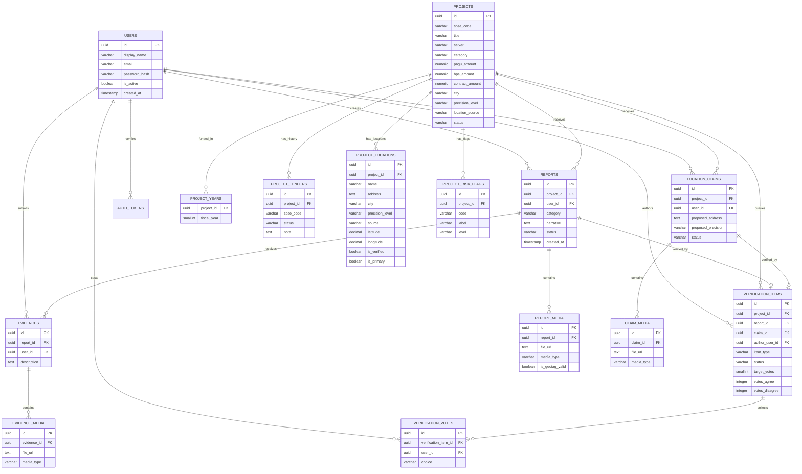

# Database Design Document

**Project:** WARTA  
**Document Version:** 1.0  
**Status:** Complete  
**Date:** 3 November 2026  
**Database:** PostgreSQL (proposed)

---

## 1. Introduction

### 1.1 Purpose

This document defines the database structure, entities, attributes, relationships, and constraints required by the WARTA application.

It serves as a reference for backend developers when implementing database schemas, migrations, and queries.

### 1.2 Scope

The database will manage:

- Citizen accounts and authentication.
- Infrastructure procurement packages and their tender history.
- Project locations, including coarse SPSE locations and citizen-submitted precise locations.
- Infrastructure progress reports.
- Report images attached to reports.
- Location claims submitted by citizens.
- Verification items and citizen votes.
- Additional evidence submitted by citizens.
- Objective risk indicators attached to projects.

The design is derived from the mockup data and screens in `admin/` and `landing/`. Both frontends share the same domain model.

### 1.3 Design Principles

1. Every report and claim must belong to one procurement package.
2. Public identity is separated from private credentials.
3. Tender history and previous locations are retained.
4. Display text such as `Rp516,02 miliar`, badges, and map distances is derived, not stored.
5. Consensus is enforced by data rules, not by an administrator.
6. Amounts are stored as exact decimals, never floating point.
7. Photos and videos are stored in object storage; the database stores references.

---

## 2. Database Overview

The database will consist of the following primary tables:

| Table | Description |
|---|---|
| users | Stores citizen account information and public display names. |
| projects | Stores canonical infrastructure procurement packages. |
| project_years | Stores the budget years associated with each project. |
| project_tenders | Stores failed and replaced tender attempts. |
| project_locations | Stores primary, canonical, and sub-locations of a project. |
| project_risk_flags | Stores objective risk indicators attached to a project. |
| reports | Stores infrastructure condition reports created by citizens. |
| report_media | Stores photos attached to reports. |
| location_claims | Stores citizen proposals for a more precise project location. |
| claim_media | Stores the evidence photo attached to a location claim. |
| verification_items | Stores the unified verification queue for reports and claims. |
| verification_votes | Stores citizen votes for verification items. |
| evidences | Stores additional information submitted for a report. |
| evidence_media | Stores photos attached to additional evidence. |
| auth_tokens | Stores single-use, hashed tokens for email verification. |

Supporting read models are described in Section 10.

---

## 3. Entity Definitions

### 3.1 Users

Stores information about registered citizens.

| Column | Data Type | Constraints |
|---|---|---|
| id | UUID | Primary Key |
| display_name | VARCHAR(24) | Unique, Not Null |
| email | VARCHAR(255) | Unique, Not Null |
| password_hash | VARCHAR(255) | Not Null |
| is_active | BOOLEAN | Not Null, Default TRUE |
| email_verified_at | TIMESTAMP | Nullable |
| created_at | TIMESTAMP | Not Null |
| updated_at | TIMESTAMP | Not Null |

**Rules:**

- `display_name` is the public identity shown on reports, claims, and votes. It must be 3–24 characters using letters, numbers, or underscores.
- `email` is private and must never appear in a public project, report, claim, or queue response.
- `password_hash` stores a one-way hash only. Plain-text passwords are forbidden.
- `email_verified_at` is null until the address is confirmed. Content writes require a non-null value; reading does not.
- `is_active` and `email_verified_at` are independent. A deactivated account stays blocked even when verified.
- No NIK, KTP number, phone number, or home address is stored.

---

### 3.2 Projects

Stores canonical infrastructure procurement packages.

| Column | Data Type | Constraints |
|---|---|---|
| id | UUID | Primary Key |
| spse_code | VARCHAR(32) | Unique, Not Null |
| title | VARCHAR(255) | Not Null |
| satker | VARCHAR(255) | Not Null |
| category | VARCHAR(100) | Not Null |
| pagu_amount | NUMERIC(20,2) | Not Null, >= 0 |
| hps_amount | NUMERIC(20,2) | Not Null, >= 0 |
| contract_amount | NUMERIC(20,2) | Nullable, >= 0 |
| contract_note | TEXT | Nullable |
| city | VARCHAR(100) | Not Null |
| is_outside_dki | BOOLEAN | Not Null, Default FALSE |
| location_description | TEXT | Not Null |
| precision_level | VARCHAR(30) | Not Null |
| location_source | VARCHAR(20) | Not Null |
| is_canonical_claimed | BOOLEAN | Not Null, Default FALSE |
| precision_resolution_note | TEXT | Nullable |
| status | VARCHAR(30) | Not Null |
| source_note | TEXT | Nullable |
| search_vector | TSVECTOR | Generated, Not Null |
| created_at | TIMESTAMP | Not Null |
| updated_at | TIMESTAMP | Not Null |

**Allowed values:**

- `precision_level`: `kabupaten/kota`, `kecamatan`, `desa/kelurahan`, `alamat/ruas`, `titik`.
- `location_source`: `SPSE`, `warga`.
- `status`: `menunggu`, `terverifikasi`, `ditolak`, `selesai`.

**Rules:**

- `spse_code` is the current public tender code.
- `contract_amount` is nullable. A null value means the contract value is not yet published; the application must show the standard explanatory message instead of `Rp0`.
- `is_canonical_claimed` is true only when the current primary location came from an accepted citizen claim.
- `status` is a cached roll-up of the project's report statuses. Reports remain the source of truth.
- `search_vector` is a generated `tsvector` over `title`, `satker`, `category`, and `city` using the `indonesian` configuration. It is never written by the application.

---

### 3.3 Project Years

Stores the budget years associated with a project.

| Column | Data Type | Constraints |
|---|---|---|
| project_id | UUID | Foreign Key → projects.id, Not Null |
| fiscal_year | SMALLINT | Not Null, 2000–2100 |
| — | — | Composite Primary Key (`project_id`, `fiscal_year`) |

**Rules:**

- A project may have multiple fiscal years, for example 2025, 2026, and 2027.
- The display string `APBD 2025, 2026, 2027` is generated from these rows.
- Filtering by budget year uses this table, not a text search.

---

### 3.4 Project Tenders

Stores failed and replaced tender attempts for a project.

| Column | Data Type | Constraints |
|---|---|---|
| id | UUID | Primary Key |
| project_id | UUID | Foreign Key → projects.id, Not Null |
| spse_code | VARCHAR(32) | Unique, Not Null |
| status | VARCHAR(30) | Not Null |
| note | TEXT | Nullable |
| created_at | TIMESTAMP | Not Null |

**Allowed values:**

- `status`: `gagal`, `aktif`, `selesai`, `dibatalkan`.

**Rules:**

- The current tender code is stored in `projects.spse_code`.
- Failed attempts are stored here and shown in the tender-history accordion.
- A failed tender note may contain the most precise address found in the source row. This supports the precision-resolution note on the project.
- Re-importing the same tender code must update the existing row, not create a duplicate.

---

### 3.5 Project Locations

Stores primary, canonical, and sub-locations of a project.

| Column | Data Type | Constraints |
|---|---|---|
| id | UUID | Primary Key |
| project_id | UUID | Foreign Key → projects.id, Not Null |
| name | VARCHAR(255) | Nullable |
| address | TEXT | Not Null |
| city | VARCHAR(100) | Not Null |
| precision_level | VARCHAR(30) | Not Null |
| source | VARCHAR(20) | Not Null |
| latitude | DECIMAL(9,6) | Nullable |
| longitude | DECIMAL(9,6) | Nullable |
| is_verified | BOOLEAN | Not Null, Default FALSE |
| is_primary | BOOLEAN | Not Null, Default FALSE |
| created_at | TIMESTAMP | Not Null |
| updated_at | TIMESTAMP | Not Null |

**Allowed values:**

- `precision_level`: `kabupaten/kota`, `kecamatan`, `desa/kelurahan`, `alamat/ruas`, `titik`.
- `source`: `SPSE`, `warga`.

**Rules:**

- Each project has exactly one primary location. A unique constraint on `(project_id)` where `is_primary` is true enforces this.
- A project may have multiple sub-locations, for example six schools at five points or four kelurahan in a sewerage package.
- A location created from an accepted claim uses `source = 'warga'`, `is_verified = true`, and becomes the primary location.
- Previous primary locations are retained as history.
- Latitude and longitude must both be present or both be null.

---

### 3.6 Project Risk Flags

Stores objective risk indicators attached to a project.

| Column | Data Type | Constraints |
|---|---|---|
| id | UUID | Primary Key |
| project_id | UUID | Foreign Key → projects.id, Not Null |
| code | VARCHAR(50) | Not Null |
| label | VARCHAR(255) | Not Null |
| description | TEXT | Not Null |
| level | VARCHAR(20) | Not Null |
| created_at | TIMESTAMP | Not Null |

**Allowed values:**

- `level`: `warning`, `info`.
- `code` examples: `CONTRACT_NEAR_HPS`, `HPS_EQUALS_PAGU`, `RETENDER_FAILED`, `CONTRACT_MISSING`, `OUTSIDE_DKI`, `MULTI_LOCATION`, `MULTI_YEAR`, `MULTI_CITY`.

**Rules:**

- A project may have at most one active row per `code`.
- Flags are generated by an evaluation rule and stored as snapshots. They are not manually typed into the UI.
- The label and description are stored because they are shown verbatim in the project detail view.

---

### 3.7 Reports

Stores infrastructure progress reports created by citizens.

| Column | Data Type | Constraints |
|---|---|---|
| id | UUID | Primary Key |
| project_id | UUID | Foreign Key → projects.id, Not Null |
| user_id | UUID | Foreign Key → users.id, Not Null |
| category | VARCHAR(30) | Nullable |
| narrative | TEXT | Not Null |
| proposed_address | TEXT | Nullable |
| latitude | DECIMAL(9,6) | Nullable |
| longitude | DECIMAL(9,6) | Nullable |
| distance_from_project | DECIMAL(10,2) | Nullable |
| exif_status | VARCHAR(20) | Not Null |
| exif_notice | TEXT | Nullable |
| status | VARCHAR(30) | Not Null |
| deleted_at | TIMESTAMP | Nullable |
| created_at | TIMESTAMP | Not Null |
| updated_at | TIMESTAMP | Not Null |
| submitted_at | TIMESTAMP | Nullable |

**Allowed values:**

- `category`: `belum_mulai`, `lambat_mangkrak`, `fisik_rusak`, `papan_tidak_ada`, `selesai`.
- `exif_status`: `valid`, `invalid`, `missing`.
- `status`: `draft`, `menunggu`, `terverifikasi`, `ditolak`, `selesai`.

**Rules:**

- A report must belong to exactly one project. Standalone reports are not allowed.
- `category` may be null only while the report is a draft.
- A submitted report requires a category, a proposed address, and a submission timestamp.
- The narrative must be 20–500 characters when submitted.
- A submitted report requires at least one row in `report_media`.
- `distance_from_project` is captured at submission time so history does not change when a project location is later corrected.
- Drafts may remain on the citizen's device and never reach the database. The table supports server-side drafts for optional synchronisation.
- `deleted_at` implements withdrawal. A `draft` may be hard-deleted; a `menunggu` report is soft-deleted so its votes and audit trail survive.
- Reports in `terverifikasi`, `ditolak`, or `selesai` must not be deleted. They are part of the public record.
- Every public read and the verification queue filter on `deleted_at IS NULL`.

---

### 3.8 Report Media

Stores photos attached to reports.

| Column | Data Type | Constraints |
|---|---|---|
| id | UUID | Primary Key |
| report_id | UUID | Foreign Key → reports.id, Not Null |
| file_url | TEXT | Not Null |
| media_type | VARCHAR(20) | Not Null |
| exif_latitude | DECIMAL(9,6) | Nullable |
| exif_longitude | DECIMAL(9,6) | Nullable |
| exif_taken_at | TIMESTAMP | Nullable |
| is_geotag_valid | BOOLEAN | Nullable |
| sort_order | SMALLINT | Not Null, 0–3 |
| created_at | TIMESTAMP | Not Null |

**Rules:**

- A report may have 1–4 photos.
- `media_type` must be an image type for report evidence.
- `file_url` points to object storage. Binary image data is not stored in the database.
- The first photo, ordered by `sort_order`, is used as the queue thumbnail.
- The EXIF columns preserve the original geotag data used for the validity badge.

---

### 3.9 Location Claims

Stores citizen proposals for a more precise project location.

| Column | Data Type | Constraints |
|---|---|---|
| id | UUID | Primary Key |
| project_id | UUID | Foreign Key → projects.id, Not Null |
| user_id | UUID | Foreign Key → users.id, Not Null |
| proposed_address | TEXT | Not Null |
| address_line | TEXT | Nullable |
| kelurahan | VARCHAR(100) | Nullable |
| kecamatan | VARCHAR(100) | Not Null |
| city | VARCHAR(100) | Nullable |
| landmark | VARCHAR(255) | Nullable |
| proposed_precision | VARCHAR(30) | Not Null |
| latitude | DECIMAL(9,6) | Nullable |
| longitude | DECIMAL(9,6) | Nullable |
| distance_from_project | DECIMAL(10,2) | Nullable |
| exif_status | VARCHAR(20) | Not Null |
| exif_notice | TEXT | Nullable |
| status | VARCHAR(30) | Not Null |
| created_at | TIMESTAMP | Not Null |
| updated_at | TIMESTAMP | Not Null |
| decided_at | TIMESTAMP | Nullable |

**Allowed values:**

- `proposed_precision`: `titik`, `alamat/ruas`, `desa/kelurahan`, `kecamatan`.
- `exif_status`: `valid`, `invalid`, `missing`.
- `status`: `menunggu`, `diterima`, `ditolak`.

**Rules:**

- A specific address is required unless the proposed precision is `kecamatan` or `desa/kelurahan`.
- A project may have at most one accepted claim.
- A claim accepted by consensus creates a new primary location with `source = 'warga'`.
- A rejected claim does not change the project location.
- Old accepted locations remain in `project_locations` as history.

---

### 3.10 Claim Media

Stores the evidence photo attached to a location claim.

| Column | Data Type | Constraints |
|---|---|---|
| id | UUID | Primary Key |
| claim_id | UUID | Foreign Key → location_claims.id, Not Null |
| file_url | TEXT | Not Null |
| media_type | VARCHAR(20) | Not Null |
| exif_latitude | DECIMAL(9,6) | Nullable |
| exif_longitude | DECIMAL(9,6) | Nullable |
| exif_taken_at | TIMESTAMP | Nullable |
| is_geotag_valid | BOOLEAN | Nullable |
| created_at | TIMESTAMP | Not Null |

**Rules:**

- A claim may have at most one evidence photo.
- The photo should show the project board or a physical landmark at the proposed location.
- `file_url` points to object storage.

---

### 3.11 Verification Items

Stores the unified verification queue for reports and location claims.

| Column | Data Type | Constraints |
|---|---|---|
| id | UUID | Primary Key |
| project_id | UUID | Foreign Key → projects.id, Not Null |
| item_type | VARCHAR(30) | Not Null |
| report_id | UUID | Foreign Key → reports.id, Nullable, Unique |
| claim_id | UUID | Foreign Key → location_claims.id, Nullable, Unique |
| author_user_id | UUID | Foreign Key → users.id, Not Null |
| status | VARCHAR(30) | Not Null |
| target_votes | SMALLINT | Not Null, Default 3 |
| votes_agree | INTEGER | Not Null, Default 0 |
| votes_disagree | INTEGER | Not Null, Default 0 |
| created_at | TIMESTAMP | Not Null |
| resolved_at | TIMESTAMP | Nullable |

**Allowed values:**

- `item_type`: `laporan_kondisi`, `klaim_lokasi`.
- `status`: `menunggu`, `terverifikasi`, `ditolak`, `diterima`.
- A claim resolves to `diterima`; a report resolves to `terverifikasi`.

**Rules:**

- Exactly one of `report_id` or `claim_id` must be present.
- `item_type` must match the populated subject: `laporan_kondisi` for reports, `klaim_lokasi` for claims.
- A report or claim may have at most one verification item.
- The default consensus threshold is 3 agree votes.
- `votes_agree` and `votes_disagree` are cached counters. The `verification_votes` table is the source of truth.
- A resolved item must have `resolved_at`; a pending item must not.
- The queue screen reads this table joined to the corresponding report or claim.

---

### 3.12 Verification Votes

Stores citizen votes for verification items.

| Column | Data Type | Constraints |
|---|---|---|
| id | UUID | Primary Key |
| verification_item_id | UUID | Foreign Key → verification_items.id, Not Null |
| user_id | UUID | Foreign Key → users.id, Not Null |
| choice | VARCHAR(20) | Not Null |
| created_at | TIMESTAMP | Not Null |

**Allowed values:**

- `choice`: `setuju`, `tidak_setuju`.

**Rules:**

- A unique constraint on `(verification_item_id, user_id)` prevents duplicate voting.
- The author of the report or claim cannot vote on their own verification item.
- Votes are immutable after submission.
- Three agree votes resolve the item as `terverifikasi`; for a claim, the accepted status is `diterima`.
- Three disagree votes resolve the item as `ditolak`.
- Votes cannot be added after an item is resolved.
- Guest users have no user row and cannot vote.

---

### 3.13 Evidences

Stores additional information submitted by citizens about an existing report.

| Column | Data Type | Constraints |
|---|---|---|
| id | UUID | Primary Key |
| report_id | UUID | Foreign Key → reports.id, Not Null |
| user_id | UUID | Foreign Key → users.id, Not Null |
| description | TEXT | Not Null |
| created_at | TIMESTAMP | Not Null |
| updated_at | TIMESTAMP | Not Null |

**Rules:**

- Evidence must reference an existing report and an existing user.
- Evidence is supporting information, not a new standalone report.
- The report author and evidence author may be different citizens.

---

### 3.14 Evidence Media

Stores photos attached to additional evidence.

| Column | Data Type | Constraints |
|---|---|---|
| id | UUID | Primary Key |
| evidence_id | UUID | Foreign Key → evidences.id, Not Null |
| file_url | TEXT | Not Null |
| media_type | VARCHAR(20) | Not Null |
| created_at | TIMESTAMP | Not Null |

**Rules:**

- Evidence may contain one or more media attachments.
- `file_url` points to object storage.
- `media_type` must be an image type.

---

### 3.15 Auth Tokens

Stores single-use tokens for email verification.

| Column | Data Type | Constraints |
|---|---|---|
| id | UUID | Primary Key |
| user_id | UUID | Foreign Key → users.id, Not Null |
| purpose | VARCHAR(30) | Not Null |
| token_hash | VARCHAR(255) | Unique, Not Null |
| expires_at | TIMESTAMP | Not Null |
| used_at | TIMESTAMP | Nullable |
| created_at | TIMESTAMP | Not Null |

**Allowed values:**

- `purpose`: `email_verification`.

**Rules:**

- Only the hash of the token is stored. The raw token appears once, in the email.
- A token is valid for 24 hours and may be used once; use sets `used_at`.
- Issuing a new token invalidates any earlier unused token for the same user and purpose.
- Expired, used, or unknown tokens are rejected without revealing which condition failed.
- `purpose` is present so password reset or other flows can reuse this table without a schema change.

---

## 4. Entity Relationship Diagram (ERD)

The following diagram illustrates how the database tables relate to one another.

---

## 5. Relationships

| Relationship | Type | Description |
|---|---|---|
| Users → Reports | One-to-Many | A citizen can create multiple condition reports. |
| Users → Location Claims | One-to-Many | A citizen can submit multiple location claims. |
| Users → Verification Items | One-to-Many | A citizen can author multiple reports or claims that enter the queue. |
| Users → Verification Votes | One-to-Many | A citizen can vote on many verification items, but only once per item. |
| Users → Evidences | One-to-Many | A citizen can submit additional evidence for multiple reports. |
| Users → Auth Tokens | One-to-Many | A citizen can receive verification tokens over time; only the newest unused token is valid. |
| Projects → Project Years | One-to-Many | A project can be funded across multiple fiscal years. |
| Projects → Project Tenders | One-to-Many | A project can have failed or replaced tender attempts. |
| Projects → Project Locations | One-to-Many | A project has one primary location and may have several sub-locations. |
| Projects → Project Risk Flags | One-to-Many | A project can carry several objective risk indicators. |
| Projects → Reports | One-to-Many | A project can receive many citizen reports. |
| Projects → Location Claims | One-to-Many | A project can receive many location claims, but only one accepted claim. |
| Projects → Verification Items | One-to-Many | A project can have many reports and claims in the verification queue. |
| Reports → Report Media | One-to-Many | A report can contain one to four photos. |
| Reports → Evidences | One-to-Many | A report can receive additional evidence from other citizens. |
| Reports → Verification Items | One-to-One | A submitted report creates exactly one verification item. |
| Location Claims → Claim Media | One-to-Many | A claim can contain one evidence photo. |
| Location Claims → Verification Items | One-to-One | A claim creates exactly one verification item. |
| Verification Items → Verification Votes | One-to-Many | A verification item collects votes from different citizens. |
| Evidences → Evidence Media | One-to-Many | An evidence submission can contain multiple media attachments. |

**Cardinality summary:**

- One user creates many reports, claims, votes, and evidence submissions.
- One project has many reports, claims, locations, years, tenders, risk flags, and verification items.
- One report has many media rows, many evidence rows, and exactly one verification item.
- One claim has one media row and exactly one verification item.
- One verification item has many votes, but at most one vote per citizen.

---

## 6. Database Constraints and Rules

The database must enforce the following rules:

1. Every report must belong to an existing user and an existing project.
2. Every location claim must belong to an existing user and an existing project.
3. Every evidence submission must belong to an existing report and an existing user.
4. Every media attachment must reference an existing report, claim, or evidence.
5. User display names and email addresses must be unique.
6. Email addresses must never be exposed in public queries.
7. A user cannot vote on the same verification item more than once.
8. A user cannot vote on a report or claim they authored.
9. A verification item must reference exactly one report or one claim, not both.
10. A report or claim can have at most one verification item.
11. A project can have at most one accepted location claim.
12. A project must have exactly one primary location.
13. A project location must have both coordinates or neither coordinate.
14. A report must have at least one photo when submitted.
15. A report may have at most four photos.
16. A claim may have at most one photo.
17. A submitted report must have a category, a proposed address, and a submitted timestamp.
18. A submitted report narrative must be between 20 and 500 characters.
19. `contract_amount` must remain null when the value is not published. It must never be replaced with zero.
20. Three agree votes resolve a verification item as verified; for a claim, the accepted status is `diterima`.
21. Three disagree votes resolve a verification item as rejected.
22. Required fields must not accept null values.
23. Foreign key constraints must maintain referential integrity.
24. Financial amounts must be stored as exact decimals, not floating-point values.
25. Timestamps must be stored in UTC.

---

## 7. Indexing Strategy

The following indexes are recommended:

| Table | Column(s) | Purpose |
|---|---|---|
| users | email | Faster authentication lookup. |
| users | display_name | Public profile and uniqueness checks. |
| projects | spse_code | Lookup by tender code. |
| projects | category | Filter by project category. |
| projects | status | Filter by project status. |
| projects | city | Filter by administrative city. |
| projects | search_vector (GIN) | Full-text search over title, satker, category, city. |
| projects | title (GIN, `pg_trgm`) | Partial-word and typo-tolerant fallback search. |
| auth_tokens | token_hash | Resolve a verification token. |
| auth_tokens | user_id, purpose | Invalidate earlier tokens when reissuing. |
| project_years | fiscal_year | Filter projects by budget year. |
| project_tenders | project_id | Load tender history for a project. |
| project_tenders | spse_code | Resolve a tender from its public code. |
| project_locations | project_id | Load primary and sub-locations. |
| project_risk_flags | project_id | Load active risk indicators. |
| reports | project_id | Load reports for a project. |
| reports | user_id | Load reports created by a citizen. |
| reports | status | Load queue and status counts. |
| reports | created_at | Sort reports by recency. |
| report_media | report_id | Load report photos. |
| location_claims | project_id | Load claims for a project. |
| location_claims | user_id | Load claims submitted by a citizen. |
| location_claims | status | Load pending and accepted claims. |
| verification_items | project_id | Load the queue for a project. |
| verification_items | status | Load the active verification queue. |
| verification_items | item_type | Filter reports versus claims. |
| verification_votes | verification_item_id | Count votes for an item. |
| verification_votes | user_id | Load a citizen's vote history. |
| evidences | report_id | Load additional evidence for a report. |
| evidence_media | evidence_id | Load evidence photos. |

The unique constraints on `users.email`, `users.display_name`, `projects.spse_code`, `project_tenders.spse_code`, `auth_tokens.token_hash`, and `(verification_item_id, user_id)` should also create or use corresponding unique indexes.

Search requires two extension-backed indexes: a GIN index on the generated `projects.search_vector` and a GIN `pg_trgm` index on `projects.title`. Both are additive and only affect query planning.

Report and queue indexes should be partial where withdrawal matters, for example `reports(project_id, created_at) WHERE deleted_at IS NULL` and `verification_items(status, created_at) WHERE status = 'menunggu'`.

---

## 8. Data Management

### 8.1 Media Storage

Images and videos should be stored in external object storage or a file storage service rather than directly inside database columns.

The database will only store the corresponding file URLs or storage references.

### 8.2 Password Security

User passwords must be hashed before being stored in the database. Plain-text passwords must never be stored.

### 8.3 Privacy

- `email` is private and must never be returned by project, report, claim, or queue endpoints.
- The public identity is `display_name`.
- No NIK, KTP number, phone number, or home address is collected.
- Guest users may browse public data but cannot create reports, claims, evidence, or votes.

### 8.4 Timestamps

Tables containing user-generated content should maintain creation and update timestamps where applicable.

Submission timestamps are stored separately from draft creation timestamps. This allows the application to distinguish an offline draft from a submitted report.

### 8.5 Financial Values

All rupiah amounts use `NUMERIC(20,2)`.

The compact and full display formats, such as `Rp516,02 miliar` and `Rp516.020.000.000`, are generated by the application and are not stored in the database.

### 8.6 Status Values

The database stores canonical status values. The UI labels, icons, and colors are presentation concerns.

| Entity | Canonical statuses |
|---|---|
| Report | `draft`, `menunggu`, `terverifikasi`, `ditolak`, `selesai` |
| Location claim | `menunggu`, `diterima`, `ditolak` |
| Verification item | `menunggu`, `terverifikasi`, `ditolak`, `diterima` |
| Project | `menunggu`, `terverifikasi`, `ditolak`, `selesai` |

### 8.7 Data Retention

- Failed tender rows are retained for transparency.
- Previous primary locations are retained as history.
- Rejected reports and claims are retained unless a retention policy is introduced later.
- Withdrawn pending reports are soft-deleted: the row and its votes are retained, but the report is hidden from public reads and the queue.
- Unused or expired verification tokens are purged after 30 days.
- Votes are immutable and retained as part of the public verification record.
- An audit trail should record automatic consensus decisions and accepted location claims.

---

## 9. Database Migrations

This section defines the migration plan. Executable migration files are intentionally outside the scope of this document.

### 9.1 Migration Approach

- Use one migration tool consistently, for example `golang-migrate`.
- Every migration must have a forward step and a rollback step.
- Migrations must be applied in order and must never be edited after being applied to a shared environment.
- Schema changes should be transactional where PostgreSQL supports it.
- Data backfills must be separate from schema creation.
- Seed data for local development must not be applied automatically to production.

### 9.2 Migration Sequence

| Migration | Name | Creates | Depends On | Rollback |
|---|---|---|---|---|
| M1 | Foundation | Users, password storage, status and category lookup values | — | Drop users and lookup values |
| M2 | Procurement | Projects, project years, tender history, project locations, risk flags | M1 | Drop procurement tables |
| M3 | Citizen Reports | Reports, report media | M1, M2 | Drop report tables |
| M4 | Location Claims | Location claims, claim media | M1, M2 | Drop claim tables |
| M5 | Verification | Verification items, verification votes | M3, M4 | Drop verification tables |
| M6 | Additional Evidence | Evidence, evidence media | M3 | Drop evidence tables |
| M7 | Read Models and Indexes | Queue view, project catalog view, location view, indexes, counters, triggers | M2–M6 | Drop views, indexes, and triggers |
| M8 | Reference Seed | Project categories and work units used by the mock data | M2 | Delete reference rows when unused |
| M9 | Verification and Search Hardening | `users.email_verified_at`, `auth_tokens`, `reports.deleted_at`, generated `projects.search_vector`, `pg_trgm` extension, GIN and partial indexes | M1–M7 | Drop the new indexes, columns, and `auth_tokens` |

### 9.3 Migration Rules

1. Create parent tables before child tables.
2. Drop child tables before parent tables during rollback.
3. Add indexes after the initial table creation so import performance can be tuned.
4. Add the unified verification queue after reports and claims exist.
5. Backfill verification items for existing submitted reports and claims before enabling the queue.
6. Backfill project statuses from report statuses after the consensus tables exist.
7. Keep reference-data seeds idempotent.
8. Keep sample project data out of production migrations.
9. Test every rollback step on a copy of the database before deployment.
10. Record the applied migration version in the deployment log.
11. `search_vector` is generated, so M9 needs no data backfill; rebuild the GIN index after the column exists.
12. Example email addresses in local seed data must be marked verified so seeded citizens can write.

### 9.4 Deployment Checklist

- [ ] Back up the database.
- [ ] Verify the migration version currently applied.
- [ ] Apply migrations in order.
- [ ] Verify foreign keys and indexes exist.
- [ ] Verify public queries do not expose email.
- [ ] Verify a report without a photo cannot be submitted.
- [ ] Verify a fourth report photo is rejected.
- [ ] Verify a second vote by the same citizen is rejected.
- [ ] Verify an author cannot vote on their own item.
- [ ] Verify three agree votes resolve the item.
- [ ] Verify an accepted claim becomes the primary project location.
- [ ] Verify an unverified account can read but receives `403` on content writes.
- [ ] Verify the queue excludes deactivated authors and withdrawn reports.
- [ ] Verify a pending report is withdrawn by soft delete, not a row removal.
- [ ] Verify search returns ranked results and falls back to trigram matching.
- [ ] Verify rollback on a staging copy.

### 9.5 Seed Data

Local development may seed:

- The eight sample projects from `wartaData.ts`.
- Their tender history, budget years, locations, and risk flags.
- Three citizens plus the current user.
- Three verification items: two condition reports and one location claim.
- The sample vote history.

Seeding must preserve the four mock edge cases:

1. A project with a missing contract value.
2. A project with failed and repeated tenders.
3. A project whose precise address came from a failed tender row.
4. A project whose canonical location came from an accepted citizen claim.

---

## 10. Read Models and Derived Data

The application should expose read models rather than storing display strings.

| Read Model | Purpose |
|---|---|
| Project Catalog View | Joins a project with its current tender, primary location, budget years, risk flags, and report counts for map cards and the landing catalog. |
| Project Location View | Returns primary and sub-locations together for the location tabs. |
| Verification Queue View | Joins a verification item with its report or claim, author display name, first photo, vote counters, and voter display names. |
| Public User View | Returns only `id`, `display_name`, and `is_active` for public display. |

The following mockup fields are intentionally derived and not stored:

- Compact and full rupiah formatting.
- Precision badges and microcopy.
- Tender-history microcopy.
- Distance text from the current user.
- Report and verification counts.
- Map SVG coordinates.
- Category labels, status labels, and icon choices.
